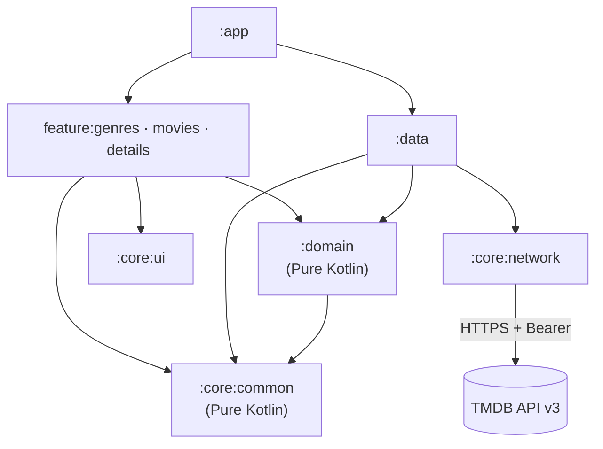
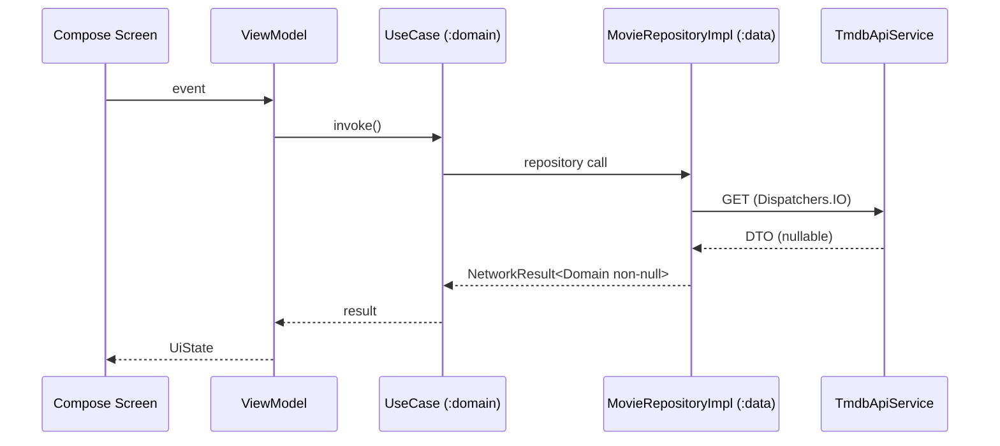

<div align="center">

# 🎬 Katha

**Katalog film Android berbasis TMDB API v3**
Multi-Module Clean Architecture · MVVM · Unidirectional Data Flow


[Arsitektur](#-arsitektur) · [Modul](#-modul) · [Alur Data](#-alur-data) · [Mulai Cepat](#-mulai-cepat) · [Dokumentasi](#-dokumentasi) · [Status](#-status)

</div>

---

## ✨ Fitur

| | Fitur | Detail |
|---|---|---|
| 🎭 | **Genre Film** | Grid genre resmi TMDB |
| 🎞️ | **Film per Genre** | Endless scrolling (Paging 3), retry saat gagal load halaman berikutnya |
| 📖 | **Detail Film** | Backdrop, poster, tagline, durasi, rating, genre, sinopsis |
| ▶️ | **Trailer** | Dibuka lewat YouTube (Trailer resmi → Trailer → Teaser) |
| 💬 | **Ulasan** | Endless scrolling di satu `LazyColumn` bersama detail |

## 🏗 Arsitektur



> Fitur **tidak boleh** meng-import `:data` atau `:core:network`. Batas ini dijaga compiler lewat dependensi Gradle.

## 📦 Modul

| Modul | Tipe | Tanggung jawab |
|---|---|---|
| `:core:common` | Pure Kotlin (JVM) | `NetworkResult`, `DispatcherProvider`, `KathaFormatters` |
| `:core:network` | Android Library | OkHttp, `AuthInterceptor`, Retrofit, `TmdbApiService`, DTO (semua field nullable), `networkModule` |
| `:domain` | Pure Kotlin (JVM) | Model non-null siap UI, `MovieRepository`, 5 use case |
| `:data` | Android Library | Mapper DTO → domain, `PagingSource`, `MovieRepositoryImpl`, `dataModule` |
| `:core:ui` | Android Compose | Tema & komponen bersama |
| `:feature:*` | Android Compose | Screen, ViewModel, `UiState`, modul Koin per fitur |

<details>
<summary><b>🔎 Detail use case (klik untuk buka)</b></summary>

| Use case | Mengembalikan |
|---|---|
| `GetGenresUseCase` | `NetworkResult<List<Genre>>` |
| `DiscoverMoviesByGenreUseCase` | `Flow<PagingData<Movie>>` |
| `GetMovieDetailUseCase` | `NetworkResult<MovieDetail>` |
| `GetMovieTrailerUseCase` | `NetworkResult<VideoTrailer?>` |
| `GetMovieReviewsUseCase` | `Flow<PagingData<Review>>` |

</details>

## 🔄 Alur Data



<details>
<summary><b>🧪 Aturan mapping penting</b></summary>

- **DTO nullable → domain non-null**: nilai kosong jadi `""` / `"N/A"`; UI cukup cek `isBlank()`.
- **Trailer**: hanya `site == "YouTube"`, urutan Trailer resmi → Trailer → Teaser; `null` bila tidak ada.
- **Paging**: halaman maksimal 500 (batas TMDB); `IOException`/`HttpException` → `LoadResult.Error`.
- **Avatar review**: `/https://...` (Gravatar) dibersihkan, path TMDB digabung ke `w185`.

</details>

## 🚀 Mulai Cepat

<details open>
<summary><b>1. Siapkan token TMDB</b></summary>

Ambil **Read Access Token** di [themoviedb.org/settings/api](https://www.themoviedb.org/settings/api), lalu tambahkan ke `local.properties` (file ini di-ignore git). **Nilai harus pakai tanda kutip** karena dipakai langsung sebagai `buildConfigField`:

```properties
TMDB_BEARER_TOKEN="eyJhbGciOi..."
```

</details>

<details open>
<summary><b>2. Build & test</b></summary>

```bash
./gradlew assembleDebug
./gradlew :domain:build :data:testDebugUnitTest
```

</details>

**Prasyarat:** JDK 17, Android Studio terbaru (AGP 9.x), minSdk 24.

## 🧰 Tech Stack

| Area | Pilihan |
|---|---|
| UI | Jetpack Compose, Material 3, Navigation 3 |
| DI | Koin 4.2.2 (Constructor DSL, tanpa KSP) |
| Network | Retrofit, OkHttp, kotlinx.serialization |
| Paging | Paging 3 |
| Gambar | Coil 3 |
| Test | JUnit, MockK, Turbine, coroutines-test |

> ⚠️ **AGP 9.0+**: jangan apply `org.jetbrains.kotlin.android` di modul Android, Kotlin sudah built-in.

## 📚 Dokumentasi

- 📋 [Product Requirements (PRD)](docs/product_requirements_document_prd.md)
- 🏛 [Arsitektur & ADR](docs/architecture_engineering_decisions.md)
- 🌐 [Spesifikasi API TMDB](docs/tmdb_api_specification.md)

## 🚧 Status

- [x] `:core:common`, `:core:network`, `:domain`, `:data`
- [ ] `:core:ui` (tema & komponen)
- [ ] `:feature:genres`, `:feature:movies`, `:feature:details`
- [ ] Wiring Koin & navigasi di `:app`
- [ ] `KoinModulesTest`

---

<div align="center">

Data film dari <a href="https://www.themoviedb.org">TMDB</a>. Aplikasi ini tidak didukung atau disertifikasi oleh TMDB.

</div>
