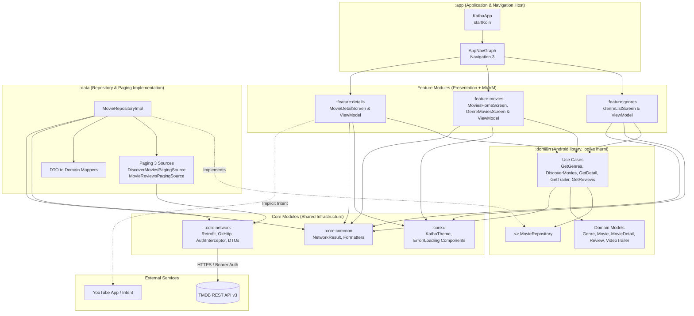
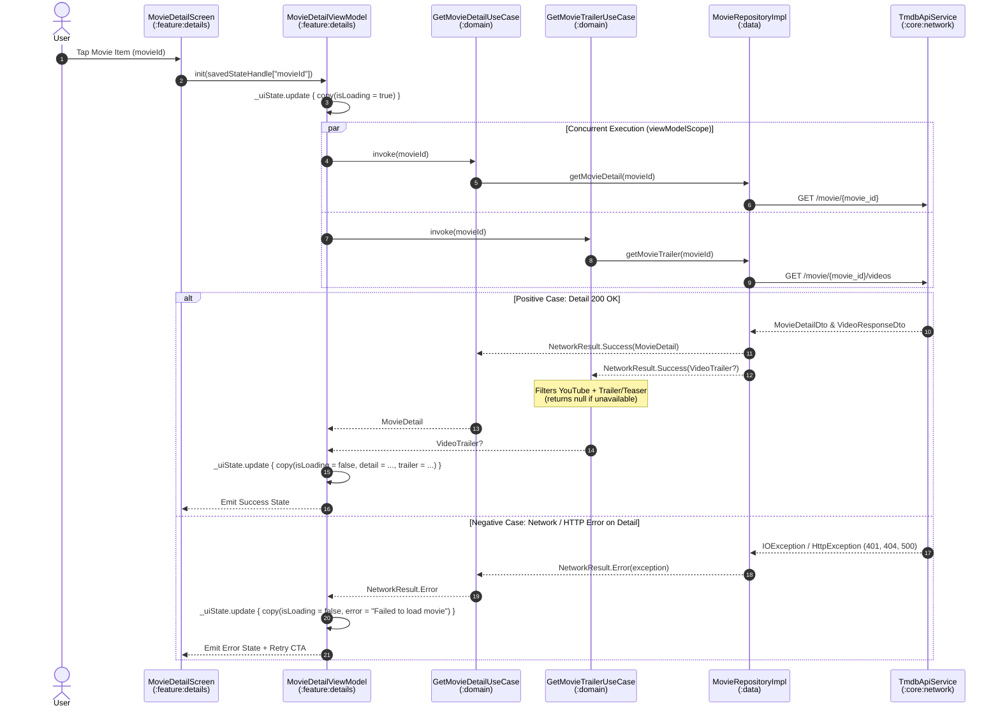
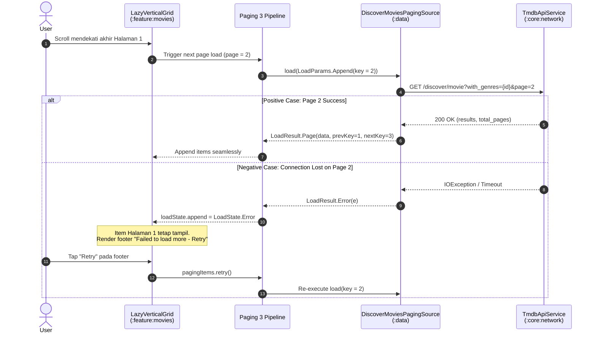
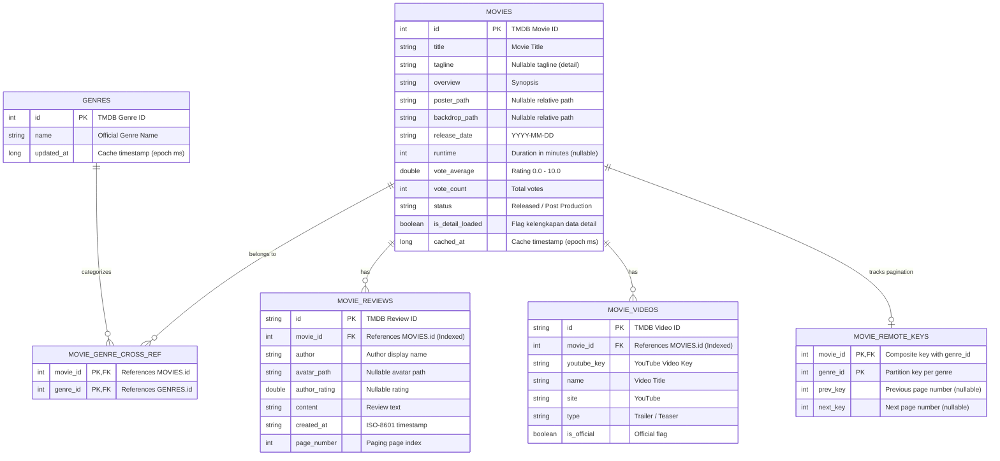

# Architecture & Engineering Decisions — Katha (`ARCHITECTURE.md`)

## 1. Multi-Module Architecture & Dependency Rules

Aplikasi **Katha** (`com.halimjr11.katha`) menerapkan **Multi-Module Clean Architecture + MVVM** dengan *Unidirectional Data Flow (UDF)*. Pemisahan modul di level Gradle memastikan batas dependensi terjaga secara fisik oleh compiler, mempercepat *incremental build*, serta menjaga modul `:domain` tetap berisi logika murni (tanpa class Android).

### A. Struktur Direktori Multi-Module

```text
Katha/
├── app/                            # Application shell, MainActivity, AppNavGraph, startKoin { ... }
├── core/
│   ├── common/                     # Android library (tanpa UI): NetworkResult<T>, DispatcherProvider, Date/Runtime formatters
│   ├── network/                    # Android Library: OkHttp, AuthInterceptor, Retrofit, TmdbApiService, DTOs
│   └── ui/                         # Android Compose: KathaTheme, FullScreenLoading, FullScreenError, PagingFooter
├── domain/                         # Android library (tanpa UI): Models, Repository Interfaces, UseCases, domainModule (tanpa class Android)
├── data/                           # Android Library: MovieRepositoryImpl, Mappers, PagingSources, dataModule
└── feature/
    ├── genres/                     # Android Compose: GenreListScreen (search field), GenreListViewModel, genresModule
    ├── movies/                     # Android Compose: MovieByGenreScreen, MovieByGenreViewModel, movieListModule
    └── details/                    # Android Compose: MovieDetailScreen, MovieDetailViewModel, movieDetailModule
```

### B. Strict Dependency Matrix
* `:app` $\rightarrow$ Mengoordinasikan seluruh modul (`:core:*`, `:domain`, `:data`, `:feature:*`) untuk merakit navigasi (`NavHost`) dan mendaftarkan seluruh Koin modules.
* `:feature:*` $\rightarrow$ **Hanya** bergantung pada `:domain`, `:core:ui`, dan `:core:common`. **Dilarang** mengakses `:data` atau `:core:network` secara langsung (setiap fitur wajib berkomunikasi melalui *Use Cases*).
* `:data` $\rightarrow$ Bergantung pada `:domain`, `:core:network`, dan `:core:common`.
* `:domain` $\rightarrow$ **Android library tanpa UI** (logika murni, tanpa class Android), bergantung pada `:core:common` (yang meng-expose `kotlinx-coroutines-core` dan bundle Koin lewat `api`) dan `androidx.paging:paging-common`. Tidak boleh bergantung pada Retrofit/OkHttp.

### C. Modular System Architecture Diagram



### D. Strategi Koin Multi-Module
* **Desentralisasi Koin Modules:** Setiap modul mendefinisikan module Koin-nya sendiri (`networkModule`, `dataModule`, `genresModule`, `movieListModule`, `movieDetailModule`).
* **`:domain` mendefinisikan `domainModule` sendiri:** `:core:common` meng-expose bundle Koin lewat `api`, sehingga `domainModule` (`factoryOf(::GetGenresUseCase)`, dst.) berada di `domain/.../di/DomainModule.kt`. `:core:common` dan `:domain` adalah Android library (bukan `java-library`) karena `koin-android` berupa AAR; modul JVM murni tidak bisa mengonsumsinya.
* **Cross-Module Verification:** `KoinModulesTest` di `:app` menggabungkan seluruh modul (`appModules`) dengan `includes(...)` dan menjalankan `.verify(extraTypes = listOf(Int::class, String::class))` untuk memvalidasi kelengkapan graf dependensi lintas modul. `Int` mewakili `movieId`/`genreId` dari `parametersOf`, `String` mewakili token yang dipakai `TokenInterceptor`.

---

## 2. Sequence Diagrams (Critical Flows & Error Handling)

### A. Parallel Detail & Trailer Fetching (Concurrency + Error Handling)

Memetakan bagaimana `MovieDetailViewModel` (`:feature:details`) mengeksekusi dua *use case* secara paralel menggunakan Coroutines `async/await` serta menangani skenario gagal (*negative case*).



### B. Endless Scrolling & Mid-Scroll Error Recovery (Paging 3)

Memetakan alur *endless scrolling* pada daftar film berdasarkan genre maupun ulasan pengguna, termasuk pemulihan saat koneksi terputus di halaman ke-2 (`append` error).



---

## 3. Architecture Decision Records (ADR)

### ADR-001: Memilih Koin 4.2.2 Dibandingkan Dagger Hilt untuk Dependency Injection

* **Context:** Proyek memiliki batas waktu pengerjaan assessment yang ketat, membutuhkan dukungan penuh Jetpack Compose (`ViewModel` + `SavedStateHandle`), serta kemudahan pengujian graf dependensi lintas modul.
* **Decision:** Menggunakan **Koin 4.2.2** (`koin-android` & `koin-androidx-compose`) dengan Constructor DSL (`singleOf`, `factoryOf`, `viewModelOf`) yang terdesentralisasi per modul.
* **Consequences:**
  * *(+) Positif:* Menghilangkan overhead kompilasi KSP/KAPT di setiap modul Gradle, mempercepat waktu *build*, dan menjaga class bersih tanpa anotasi framework (`@HiltAndroidApp`, `@AndroidEntryPoint`).
  * *(-) Negatif:* Resolusi dependensi terjadi saat *runtime*, bukan *compile-time*.
  * *(Mitigasi):* Menambahkan unit test `KoinModulesTest` di `:app` menggunakan `module.verify()` dari `koin-test-junit4` untuk memvalidasi kelengkapan graf dependensi lintas modul secara otomatis.

### ADR-002: Menggunakan Jetpack Paging 3 untuk Endless Scrolling (Movies & Reviews)

* **Context:** AC #2, #4, #6, dan #7 mewajibkan *endless scrolling* pada daftar film dan ulasan pengguna beserta penanganan *negative cases* (error saat *initial load* maupun saat *load-more* di tengah scroll).
* **Decision:** Mengimplementasikan `PagingSource` (`DiscoverMoviesPagingSource` & `MovieReviewsPagingSource`) di modul `:data` yang terekspos sebagai `Flow<PagingData<T>>` melalui `:domain` dan dikonsumsi di `:feature:*` menggunakan `collectAsLazyPagingItems()`.
* **Consequences:**
  * *(+) Positif:* Manajemen state halaman (`Refresh`, `Append`, `Prepend`), pembatalan *request* otomatis saat scroll cepat, dan mekanisme `pagingItems.retry()` sudah terstandarisasi tanpa risiko *race condition* atau *duplicate items*.
  * *(-) Negatif:* Memerlukan komponen footer khusus (`:core:ui`) untuk merender indikator *loading* dan tombol *retry* pada `loadState.append`.

### ADR-003: Single `LazyColumn` pada `MovieDetailScreen` untuk Detail & Ulasan Berpaginasi

* **Context:** Halaman detail (`:feature:details`) menampilkan informasi utama film, tombol trailer YouTube, dan daftar ulasan pengguna yang mendukung *endless scrolling*.
* **Decision:** Menyatukan seluruh elemen halaman detail ke dalam satu `LazyColumn` menggunakan blok `item { ... }` untuk header/sinopsis dan `items(reviews.itemCount)` untuk ulasan, dibandingkan membungkusnya dalam `Column(Modifier.verticalScroll(...))`.
* **Consequences:**
  * *(+) Positif:* Menghindari *runtime crash* akibat *nested scrollable containers* dengan tinggi tak terbatas (*infinite height constraints*) di Jetpack Compose, sekaligus menjaga performa *recycling* item ulasan tetap optimal.

### ADR-004: Eksekusi YouTube Trailer via Native Intent Launcher

* **Context:** AC #5 meminta pemutaran trailer YouTube untuk film yang dipilih.
* **Decision:** Memfilter video resmi YouTube (`site == "YouTube"`, prioritas `type == "Trailer"` lalu `"Teaser"`) pada layer Domain/Mapper dan membukanya menggunakan `Intent.ACTION_VIEW` (`https://www.youtube.com/watch?v={key}`).
* **Consequences:**
  * *(+) Positif:* Menghindari isu kompatibilitas WebView/iframe player (seperti *YouTube Error 152/153* pada video berhak cipta), memberikan pengalaman pemutaran layar penuh bawaan perangkat, serta mendukung *graceful fallback* ke browser jika aplikasi YouTube tidak terpasang.

### ADR-005: Tanpa Database Lokal (Room) pada Iterasi MVP Assessment

* **Context:** Fokus utama assessment adalah eksplorasi API TMDB secara *real-time*, *pagination*, dan ketahanan terhadap *error states*.
* **Decision:** Tidak menyertakan Room DB / `RemoteMediator` pada versi ini; seluruh data diambil langsung dari jaringan melalui `:data`.
* **Consequences:**
  * *(+) Positif:* Mengurangi kompleksitas skema migrasi dan sinkronisasi cache sehingga waktu pengembangan terfokus pada kualitas UI Compose, modularisasi, dan *unit testing*.
  * *(Future Improvement):* Dapat ditambahkan modul `:core:database` (Room) sebagai *Single Source of Truth* apabila kebutuhan *offline-first* diperlukan di masa mendatang (lihat Bagian 4).

### ADR-006: Multi-Module Architecture by Layer & Feature (`:core`, `:domain`, `:data`, `:feature:*`)

* **Context:** Aplikasi memiliki tiga alur fitur utama (Daftar Genre, Daftar Film Berpaginasi, Detail + Trailer + Ulasan) dan membutuhkan pembatasan arsitektur yang tegas agar layer UI tidak mengakses DTO jaringan secara langsung.
* **Decision:** Memecah proyek menjadi modul `:core:common`, `:core:network`, `:core:ui`, `:domain` (*logika murni*), `:data`, serta modul fitur independen (`:feature:genres`, `:feature:movies`, `:feature:details`).
* **Consequences:**
  * *(+) Positif:* Enforced dependency boundaries di level compiler (modul `:feature:*` tidak dapat mengimpor Retrofit/DTO), kompilasi paralel Gradle lebih cepat, dan `:domain` dapat diuji menggunakan JUnit murni tanpa emulator/Robolectric.
  * *(-) Negatif:* Penambahan konfigurasi Gradle awal antar-modul.
  * *(Mitigasi):* Menggunakan Gradle Version Catalog (`libs.versions.toml`) terpusat dan desentralisasi deklarasi Koin module per fitur.

---

## 4. Entity Relationship Diagram (ERD) & Local Database Schema (Room / SQLite)

> **Catatan Konteks:** Sesuai **ADR-005**, database lokal (Room) tidak diaktifkan pada iterasi MVP assessment ini untuk menjaga kecepatan eksekusi. Skema di bawah ini merupakan rancangan resmi untuk *Phase 2 (`:core:database` — Offline-First & Paging 3 `RemoteMediator`)* sekaligus merepresentasikan relasi antar-entitas domain di dalam aplikasi **Katha**.

### A. Entity Relationship Diagram (Mermaid ERD)



### B. Penjelasan Relasi & Strategi Indexing (Room / SQLite)

1. **Relasi Many-to-Many (`MOVIES` ↔ `GENRES` via `MOVIE_GENRE_CROSS_REF`):**
   * Satu film dapat memiliki banyak genre (*Action, Adventure, Sci-Fi*), dan satu genre mencakup banyak film.
   * Menggunakan tabel perantara `movie_genre_cross_ref` dengan *Composite Primary Key* `(movie_id, genre_id)` serta indeks pada `genre_id` agar *query* filter film berdasarkan genre (`@Transaction` + `@Relation`) berjalan cepat tanpa duplikasi data film.
2. **Relasi One-to-Many dengan Cascade Delete (`MOVIES` → `MOVIE_REVIEWS` & `MOVIE_VIDEOS`):**
   * Menggunakan `ForeignKey.CASCADE` pada `movie_id` sehingga ketika data film lama dibersihkan dari cache (*cache eviction*), seluruh ulasan dan trailer terkait otomatis terhapus tanpa meninggalkan *orphan records*.
   * Kolom `movie_id` diberi `@Index(value = ["movie_id"])` untuk mencegah *full table scan* saat memuat detail film.
3. **Pagination State Tracking (`MOVIE_REMOTE_KEYS`):**
   * Mendukung `RemoteMediator` pada Paging 3 ketika aplikasi ditingkatkan ke mode *offline-first*.
   * Menggunakan *Composite Primary Key* `(movie_id, genre_id)` karena satu film yang sama bisa muncul pada urutan halaman yang berbeda di genre *Action* maupun *Comedy*.
4. **Partial vs Full Entity Hydration (`is_detail_loaded` pada `MOVIES`):**
   * Endpoint `/discover/movie` hanya mengembalikan ringkasan film (`runtime` dan `tagline` belum tersedia), sedangkan `/movie/{id}` mengembalikan data lengkap. Flag `is_detail_loaded` mencegah data ringkasan dari endpoint *discover* menimpa kolom detail yang sudah tersimpan saat terjadi *upsert*.

---

## 5. Strategi Testing & Status

| Lapisan | Status |
|---|---|
| Unit test (JUnit 5 Jupiter dengan `@ParameterizedTest`, MockK, Turbine, coroutines-test, paging-testing): formatter, DTO parsing, `TokenInterceptor`, use case, mapper, `PagingSource`, `MovieRepositoryImpl`, ViewModel, verifikasi graf Koin | Selesai (142 test) |
| Uji manual di emulator (lihat `qa_test_cases_and_summary.md`) | Selesai |
| Compose UI test dan instrumented test (`androidTest`) | **Segera ditambahkan** |
